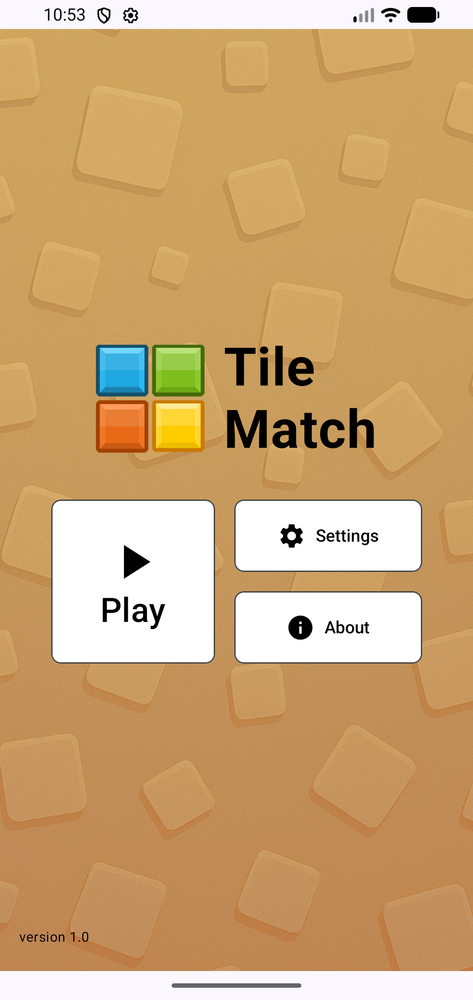
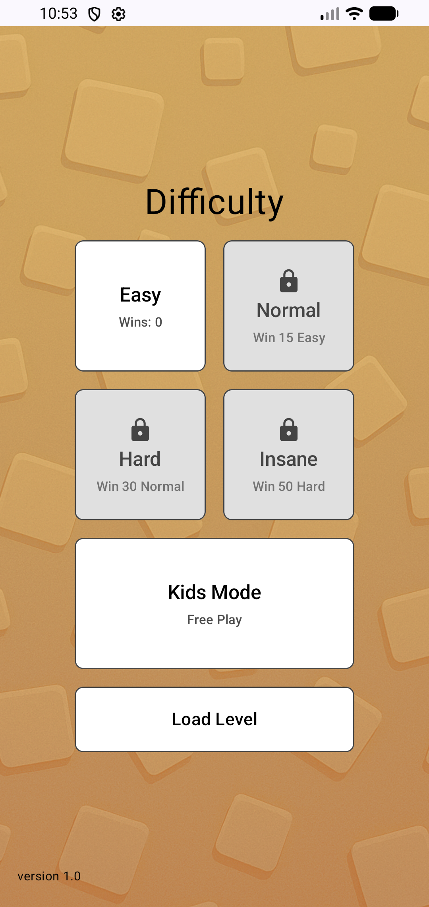

# 🧩 Tile Match

<p align="center">
  <a href="https://f-droid.org/packages/infrared.tilematch/">
    
  </a>
</p>

**Tile Match** is a free & open-source tile-collecting puzzle game for Android. Pick tiles from the board and match 3 of the same color in the bar below — but don't let the bar fill up!

[](https://developer.android.com)
[](https://kotlinlang.org)
[](https://developer.android.com/compose)
[](https://f-droid.org/packages/infrared.tilematch/)
[](LICENSE.md)
[](LICENSE.md)

---

## 📱 Screenshots

| Menu | Gameplay |
|:---:|:---:|
|  |  |

## 🎮 How to Play

1. **Tap a tile** on the board — it moves to the collection bar at the bottom
2. **Match 3 tiles** of the same color in the bar to clear them
3. **Don't fill the bar!** It only has 7 slots — if all slots are occupied with no match, it's game over
4. **Clear all tiles** from the board to complete the level
5. **Think strategically** — the order you pick tiles matters!

## ✨ Features

- 🧠 Endlessly generated puzzle boards (no two levels alike)
- 🔊 Original sound effects (all CC0, bundled in the app)
- 📴 **100% offline** — no ads, no trackers, no permissions
- 🐦 Small, lightweight APK
- 🛠 Built with modern Android tooling

## 🛠 Tech Stack

| | |
|---|---|
| **Language** | Kotlin |
| **UI** | Jetpack Compose |
| **Min SDK / Target SDK** | 24 / 35 |
| **Persistence** | Local progress & settings managers |
| **Tracking** | None — fully offline, FOSS release |

## 📦 Installation

### Via F-Droid (Recommended)

1. Install [F-Droid](https://f-droid.org) on your Android device
2. Search for **"Tile Match"**
3. Tap **Install**

Or use the direct link: [Tile Match on F-Droid](https://f-droid.org/packages/infrared.tilematch/)

### Build from source

```bash
git clone https://github.com/awaisdev5765/tile-match.git
cd tile-match
./gradlew assembleRelease
```

Requires **Android Studio** with the Android SDK 35+.

## 📂 Project Structure

```
app/src/main/java/infrared/tilematch/
├── gamelogic/       # Map generator & game-state coder
├── data/            # Game state model
├── managers/        # Progress, settings & sound managers
├── ui/              # Compose screens & components
├── utils/           # Helpers
└── constants/       # Game constants
```

## 🤝 Contributing

Contributions are welcome!

1. Fork the repository
2. Create a feature branch (`git checkout -b feature/amazing-feature`)
3. Commit your changes (`git commit -m 'Add amazing feature'`)
4. Push to the branch (`git push origin feature/amazing-feature`)
5. Open a pull request

## ☕ Support

If you enjoy the game, please consider supporting my work:

<p align="center">
  <a href="https://buymeacoffee.com/awaisdev572">
    
  </a>
</p>

Or [become a supporter on Buy Me a Coffee](https://buymeacoffee.com/awaisdev572) 💛

## 📄 License

This project uses multiple licenses for different components — see [LICENSE.md](LICENSE.md) for details:

- **Source code:** [GNU GPLv3](LICENSE.md)
- **Assets (art & sounds):** [CC0 1.0 Universal](LICENSE.md) (Public Domain)

## 📬 Contact

Having issues or questions? awaisdev5765@gmail.com
